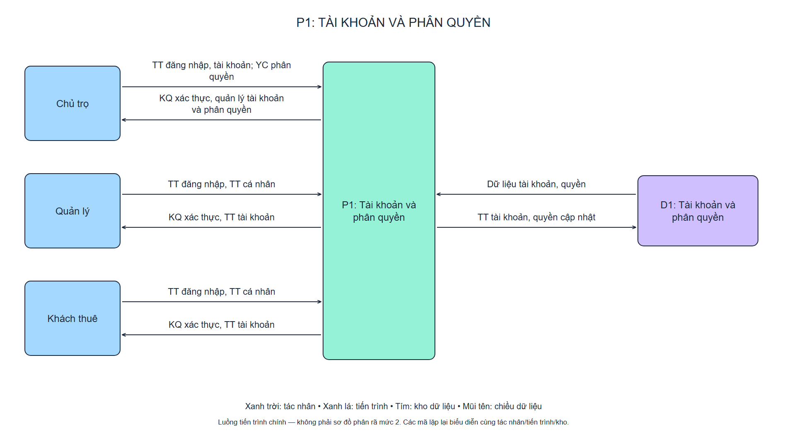
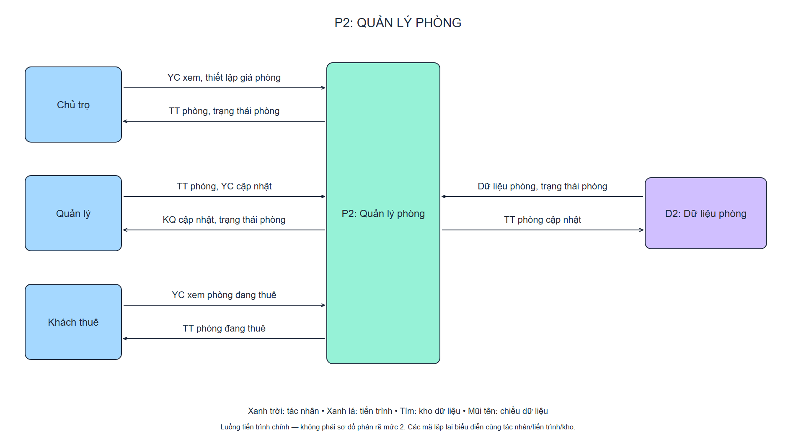
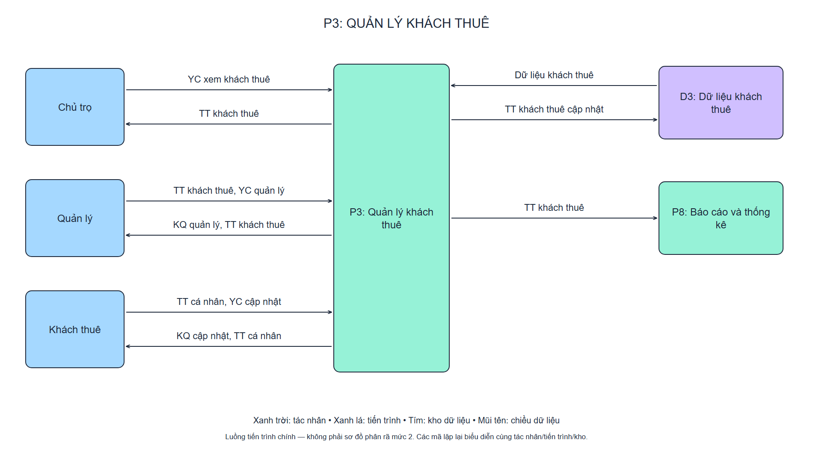
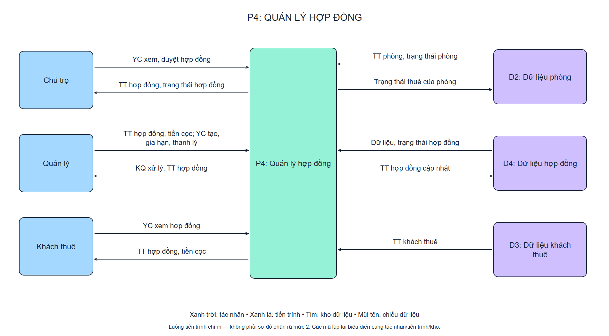
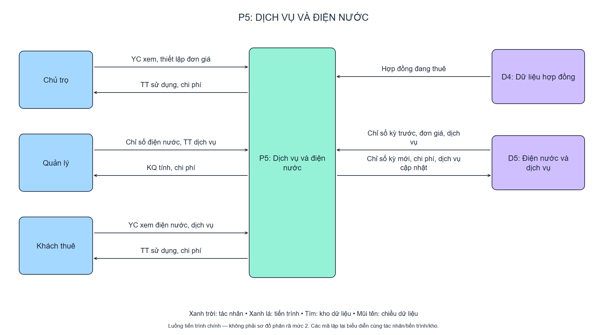
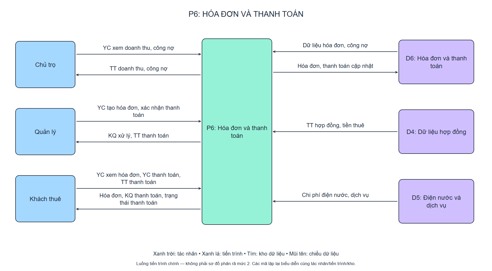
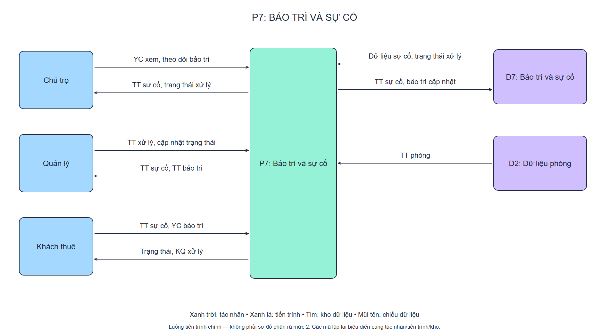
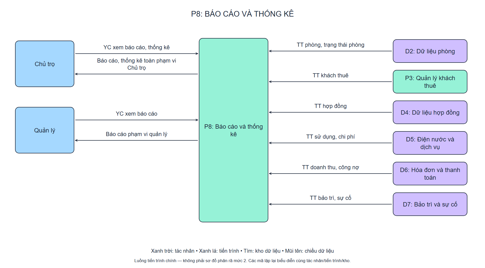

# LUỒNG HOẠT ĐỘNG CHÍNH THỨC — HỆ THỐNG VẬN HÀNH NHÀ TRỌ

> **Mục đích:** Tài liệu tham khảo cho nhóm và AI, mô tả tác nhân, tiến trình, kho dữ liệu và chiều trao đổi dữ liệu.  
> **Phạm vi:** Luồng nghiệp vụ chính; không đặc tả công nghệ, CSDL vật lý, API, giao diện hoặc thuật toán xử lý.  
> **Nguồn sơ đồ hiện hành:** [bieudochot.excalidraw](bieudochot.excalidraw).  
> **Bản tổng hợp:** [dfd_tong_the.svg](image/dfd_tong_the.svg).  
> **Cập nhật:** 08/10/2026.

## 1. Quy ước và phạm vi

- **TT:** thông tin; **YC:** yêu cầu; **KQ:** kết quả.
- **P1–P8:** tám tiến trình nghiệp vụ chính; **D1–D7:** bảy kho dữ liệu logic, không phải bảy bảng CSDL.
- Mũi tên `A → B` nghĩa là dữ liệu đi từ A đến B. Chiều đọc kho là `D → P`; chiều ghi kho là `P → D`.
- Màu xanh trời: tác nhân; xanh lá: tiến trình; tím: kho dữ liệu.
- Những tác nhân/kho/tiến trình có cùng tên và mã xuất hiện ở nhiều vùng là **cùng một đối tượng được biểu diễn lặp lại** cho dễ đọc, không phải đối tượng mới.
- Tám ảnh là luồng của các tiến trình chính, **không phải DFD mức 2** vì chưa phân rã thành tiến trình con.
- Sơ đồ tổng hợp được chia thành tám vùng tương ứng P1–P8 để tránh các đường và chữ chồng nhau. Đây là cách trình bày cùng luồng chính thức, không bổ sung chức năng mới.
- Các thành viên phụ trách từng chức năng sẽ đặc tả chi tiết và mở rộng sau. Không suy ra yêu cầu triển khai từ những chi tiết chưa có trong tài liệu này.

## 2. Tác nhân

| Tác nhân | Vai trò trong luồng chính |
| --- | --- |
| **Chủ trọ** | Kiểm soát/giám sát; quản lý tài khoản và phân quyền; thiết lập giá phòng, đơn giá; duyệt hợp đồng; theo dõi doanh thu, công nợ, sự cố và báo cáo |
| **Quản lý** | Trực tiếp vận hành; cập nhật phòng, khách thuê; xử lý hợp đồng; ghi chỉ số; lập hóa đơn và xác nhận thanh toán; cập nhật xử lý sự cố |
| **Khách thuê** | Sử dụng hệ thống và quản lý dữ liệu cá nhân; xem phòng, hợp đồng, tiền cọc, điện nước, hóa đơn; yêu cầu thanh toán hóa đơn, gửi thông tin thanh toán, nhận kết quả và gửi yêu cầu bảo trì |

Khách thuê chỉ truy cập dữ liệu liên quan đến mình; Quản lý xem báo cáo trong phạm vi được giao. Cơ chế phân quyền cụ thể thuộc phần thiết kế chi tiết sau này.

## 3. Tiến trình và kho dữ liệu

### 3.1. Tiến trình

| Mã | Tên | Nội dung chính |
| --- | --- | --- |
| P1 | Tài khoản và phân quyền | Tiếp nhận đăng nhập, thông tin tài khoản; trả kết quả xác thực và xử lý phân quyền |
| P2 | Quản lý phòng | Tra cứu/cập nhật thông tin phòng, giá phòng và trạng thái |
| P3 | Quản lý khách thuê | Tra cứu/cập nhật hồ sơ khách thuê; cung cấp thông tin khách cho báo cáo |
| P4 | Quản lý hợp đồng | Tạo, duyệt, gia hạn, thanh lý hợp đồng; quản lý thông tin tiền cọc; cập nhật trạng thái thuê của phòng |
| P5 | Dịch vụ và điện nước | Tiếp nhận chỉ số/dịch vụ, đơn giá; ghi nhận sử dụng và chi phí |
| P6 | Hóa đơn và thanh toán | Lập/tra cứu hóa đơn, tiếp nhận yêu cầu và thông tin thanh toán của Khách thuê, xử lý xác nhận của Quản lý, trả kết quả thanh toán và cung cấp doanh thu/công nợ |
| P7 | Bảo trì và sự cố | Tiếp nhận yêu cầu sự cố, cập nhật bảo trì và trả kết quả/trạng thái xử lý |
| P8 | Báo cáo và thống kê | Tổng hợp dữ liệu nghiệp vụ, trả báo cáo theo phạm vi tác nhân |

### 3.2. Kho dữ liệu

| Mã | Tên | Nội dung lưu trữ ở mức logic |
| --- | --- | --- |
| D1 | Tài khoản và phân quyền | Tài khoản, dữ liệu xác thực, quyền |
| D2 | Dữ liệu phòng | Thông tin phòng, giá phòng, trạng thái phòng |
| D3 | Dữ liệu khách thuê | Hồ sơ và thông tin cá nhân khách thuê |
| D4 | Dữ liệu hợp đồng | Thông tin/trạng thái hợp đồng và tiền cọc |
| D5 | Điện nước và dịch vụ | Chỉ số, đơn giá, dịch vụ, sử dụng và chi phí |
| D6 | Hóa đơn và thanh toán | Hóa đơn, thanh toán, thông tin doanh thu và công nợ |
| D7 | Bảo trì và sự cố | Sự cố, thông tin bảo trì, trạng thái và kết quả xử lý |

P8 không có kho dữ liệu riêng trong luồng chính thức.

## 4. Luồng dữ liệu chính thức

### 4.1. P1 — Tài khoản và phân quyền

| Nguồn → Đích | Dữ liệu trao đổi |
| --- | --- |
| Chủ trọ → P1 | TT đăng nhập, tài khoản; YC phân quyền |
| P1 → Chủ trọ | KQ xác thực, quản lý tài khoản và phân quyền |
| Quản lý → P1 | TT đăng nhập, TT cá nhân |
| P1 → Quản lý | KQ xác thực, TT tài khoản |
| Khách thuê → P1 | TT đăng nhập, TT cá nhân |
| P1 → Khách thuê | KQ xác thực, TT tài khoản |
| D1 → P1 | Dữ liệu tài khoản, quyền |
| P1 → D1 | TT tài khoản, quyền cập nhật |

**Diễn giải:** Cả ba tác nhân đều đăng nhập qua P1. Chủ trọ gửi thêm thông tin quản lý tài khoản/phân quyền; P1 đọc D1 để xử lý và ghi lại thông tin cập nhật.

### 4.2. P2 — Quản lý phòng

| Nguồn → Đích | Dữ liệu trao đổi |
| --- | --- |
| Chủ trọ → P2 | YC xem, thiết lập giá phòng |
| P2 → Chủ trọ | TT phòng, trạng thái phòng |
| Quản lý → P2 | TT phòng, YC cập nhật |
| P2 → Quản lý | KQ cập nhật, trạng thái phòng |
| Khách thuê → P2 | YC xem phòng đang thuê |
| P2 → Khách thuê | TT phòng đang thuê |
| D2 → P2 | Dữ liệu phòng, trạng thái phòng |
| P2 → D2 | TT phòng cập nhật |

**Diễn giải:** Chủ trọ xem/thiết lập giá; Quản lý cập nhật thông tin phòng; Khách thuê xem phòng đang thuê. D2 cung cấp dữ liệu và nhận cập nhật từ P2.

### 4.3. P3 — Quản lý khách thuê

| Nguồn → Đích | Dữ liệu trao đổi |
| --- | --- |
| Chủ trọ → P3 | YC xem khách thuê |
| P3 → Chủ trọ | TT khách thuê |
| Quản lý → P3 | TT khách thuê, YC quản lý |
| P3 → Quản lý | KQ quản lý, TT khách thuê |
| Khách thuê → P3 | TT cá nhân, YC cập nhật |
| P3 → Khách thuê | KQ cập nhật, TT cá nhân |
| D3 → P3 | Dữ liệu khách thuê |
| P3 → D3 | TT khách thuê cập nhật |
| P3 → P8 | TT khách thuê |

**Diễn giải:** P3 quản lý hồ sơ khách thuê tại D3 và cung cấp TT khách thuê cho P8. Luồng P3 → P8 được giữ như sơ đồ gốc; không đổi thành một kho báo cáo mới.

### 4.4. P4 — Quản lý hợp đồng

| Nguồn → Đích | Dữ liệu trao đổi |
| --- | --- |
| Chủ trọ → P4 | YC xem, duyệt hợp đồng |
| P4 → Chủ trọ | TT hợp đồng, trạng thái hợp đồng |
| Quản lý → P4 | TT hợp đồng, tiền cọc; YC tạo, gia hạn, thanh lý |
| P4 → Quản lý | KQ xử lý, TT hợp đồng |
| Khách thuê → P4 | YC xem hợp đồng |
| P4 → Khách thuê | TT hợp đồng, tiền cọc |
| D2 → P4 | TT phòng, trạng thái phòng |
| P4 → D2 | Trạng thái thuê của phòng |
| D4 → P4 | Dữ liệu, trạng thái hợp đồng |
| P4 → D4 | TT hợp đồng cập nhật |
| D3 → P4 | TT khách thuê |

**Diễn giải:** P4 sử dụng thông tin phòng và khách thuê để xử lý hợp đồng, ghi dữ liệu vào D4 và cập nhật trạng thái thuê tại D2. Tiền cọc nằm trong nghiệp vụ hợp đồng, không tách thêm tiến trình ở mức này.

### 4.5. P5 — Dịch vụ và điện nước

| Nguồn → Đích | Dữ liệu trao đổi |
| --- | --- |
| Chủ trọ → P5 | YC xem, thiết lập đơn giá |
| P5 → Chủ trọ | TT sử dụng, chi phí |
| Quản lý → P5 | Chỉ số điện nước, TT dịch vụ |
| P5 → Quản lý | KQ tính, chi phí |
| Khách thuê → P5 | YC xem điện nước, dịch vụ |
| P5 → Khách thuê | TT sử dụng, chi phí |
| D4 → P5 | Hợp đồng đang thuê |
| D5 → P5 | Chỉ số kỳ trước, đơn giá, dịch vụ |
| P5 → D5 | Chỉ số kỳ mới, chi phí, dịch vụ cập nhật |

**Diễn giải:** P5 nhận chỉ số và thông tin dịch vụ từ Quản lý, sử dụng đơn giá/chỉ số kỳ trước và hợp đồng đang thuê để xử lý dữ liệu kỳ mới. Chi phí lưu tại D5 được cung cấp cho P6.

### 4.6. P6 — Hóa đơn và thanh toán

| Nguồn → Đích | Dữ liệu trao đổi |
| --- | --- |
| Chủ trọ → P6 | YC xem doanh thu, công nợ |
| P6 → Chủ trọ | TT doanh thu, công nợ |
| Quản lý → P6 | YC tạo hóa đơn, xác nhận thanh toán |
| P6 → Quản lý | KQ xử lý, TT thanh toán |
| Khách thuê → P6 | YC xem hóa đơn, YC thanh toán, TT thanh toán |
| P6 → Khách thuê | Hóa đơn, KQ thanh toán, trạng thái thanh toán |
| D6 → P6 | Dữ liệu hóa đơn, công nợ |
| P6 → D6 | Hóa đơn, thanh toán cập nhật |
| D4 → P6 | TT hợp đồng, tiền thuê |
| D5 → P6 | Chi phí điện nước, dịch vụ |

**Diễn giải:** P6 lấy tiền thuê từ D4 và chi phí từ D5 để xử lý hóa đơn. Khách thuê không chỉ xem hóa đơn mà còn chủ động yêu cầu thanh toán và cung cấp TT thanh toán. Quản lý kiểm tra/xác nhận; P6 cập nhật D6 và trả kết quả cùng trạng thái cho Khách thuê. Yêu cầu thanh toán của Khách thuê và xác nhận thanh toán của Quản lý là hai luồng khác nhau; gửi yêu cầu không đồng nghĩa đã thanh toán thành công.

**Luồng thanh toán phía Khách thuê:**
1. Khách thuê yêu cầu xem hóa đơn; P6 đọc D6 và trả thông tin hóa đơn.
2. Khách thuê chọn hóa đơn cần trả, gửi YC thanh toán và TT thanh toán tới P6.
3. P6 ghi nhận thông tin tại D6 và cung cấp TT thanh toán cho Quản lý.
4. Quản lý kiểm tra rồi gửi thông tin xác nhận thanh toán tới P6.
5. P6 cập nhật thanh toán tại D6, trả KQ thanh toán và trạng thái hóa đơn cho Khách thuê.

Đây là luồng chính, không chốt phương thức thu tiền hoặc cách triển khai thanh toán. Không tách thêm tiến trình ngoài P6 ở mức này.

### 4.7. P7 — Bảo trì và sự cố

| Nguồn → Đích | Dữ liệu trao đổi |
| --- | --- |
| Chủ trọ → P7 | YC xem, theo dõi bảo trì |
| P7 → Chủ trọ | TT sự cố, trạng thái xử lý |
| Quản lý → P7 | TT xử lý, cập nhật trạng thái |
| P7 → Quản lý | TT sự cố, TT bảo trì |
| Khách thuê → P7 | TT sự cố, YC bảo trì |
| P7 → Khách thuê | Trạng thái, KQ xử lý |
| D7 → P7 | Dữ liệu sự cố, trạng thái xử lý |
| P7 → D7 | TT sự cố, bảo trì cập nhật |
| D2 → P7 | TT phòng |

**Diễn giải:** Khách thuê báo sự cố; P7 cung cấp thông tin cho Quản lý xử lý và Chủ trọ theo dõi. Thông tin phòng lấy từ D2; dữ liệu bảo trì/sự cố được đọc và cập nhật tại D7.

### 4.8. P8 — Báo cáo và thống kê

| Nguồn → Đích | Dữ liệu trao đổi |
| --- | --- |
| Chủ trọ → P8 | YC xem báo cáo, thống kê |
| P8 → Chủ trọ | Báo cáo, thống kê toàn phạm vi Chủ trọ |
| Quản lý → P8 | YC xem báo cáo |
| P8 → Quản lý | Báo cáo phạm vi quản lý |
| D2 → P8 | TT phòng, trạng thái phòng |
| P3 → P8 | TT khách thuê |
| D4 → P8 | TT hợp đồng |
| D5 → P8 | TT sử dụng, chi phí |
| D6 → P8 | TT doanh thu, công nợ |
| D7 → P8 | TT bảo trì, sự cố |

**Diễn giải:** P8 tổng hợp dữ liệu từ các nguồn nghiệp vụ và trả báo cáo cho Chủ trọ/Quản lý. Khách thuê không có luồng báo cáo quản trị trong sơ đồ này. “Toàn phạm vi Chủ trọ” tương ứng “toàn hệ thống” trong ảnh trước, phân biệt với phạm vi Quản lý.

## 5. Mối liên hệ giữa các chức năng

1. **Tài khoản:** Các tác nhân trao đổi dữ liệu đăng nhập/tài khoản qua P1 và D1.
2. **Hợp đồng:** P4 sử dụng phòng tại D2 và khách thuê tại D3; kết quả hợp đồng lưu D4, trạng thái thuê cập nhật D2.
3. **Điện nước/dịch vụ:** P5 đọc hợp đồng đang thuê từ D4, đọc dữ liệu kỳ trước/đơn giá từ D5 và ghi dữ liệu kỳ mới vào D5.
4. **Hóa đơn/thanh toán:** P6 sử dụng D4, D5 và D6; tiếp nhận YC/TT thanh toán từ Khách thuê và xác nhận từ Quản lý; ghi kết quả vào D6 và trả KQ/trạng thái thanh toán cho Khách thuê.
5. **Sự cố:** P7 đối chiếu thông tin phòng D2, đọc/ghi sự cố tại D7 và trao đổi kết quả với các tác nhân.
6. **Báo cáo:** P8 nhận TT khách thuê từ P3, cùng thông tin tại D2, D4, D5, D6, D7; không ghi ngược dữ liệu vào các kho trong luồng hiện tại.

Đây là các mối liên hệ dữ liệu, không phải yêu cầu mọi thao tác phải thực hiện tuần tự từ P1 đến P8.

## 6. Những lỗi sơ đồ đã sửa

| Vị trí | Nội dung sửa |
| --- | --- |
| P1 | Sửa chữ thiếu ở nhãn đăng nhập Khách thuê; thể hiện xác thực cho Chủ trọ trong luồng vào/ra hiện có |
| P3 | Sửa đúng nhãn đọc D3 → P3 và ghi P3 → D3 |
| P4 | Sửa chiều yêu cầu xem của Khách thuê và chiều trả hợp đồng/tiền cọc; thể hiện đúng chiều đọc/ghi D4; giữ luồng đọc D2 và cập nhật trạng thái phòng |
| P6 | Thể hiện đủ chiều trả doanh thu/công nợ cho Chủ trọ, thay nhãn yêu cầu bị gắn nhầm trên chiều trả |
| P6 — phía Khách thuê | Thể hiện rõ YC thanh toán từ Khách thuê và KQ thanh toán trả về; không chỉ mô tả tra cứu hóa đơn/gửi thông tin |
| P7 | Sửa “Báo trì” thành “Bảo trì”; tách các nhãn chồng nhau; dùng “TT sự cố” cho dữ liệu P7 gửi Quản lý |
| Toàn bộ | Gắn mã P1–P8/D1–D7, chuẩn hóa tên; tách đường vào/ra và bố cục để không chồng chữ; bỏ nhãn DFD mức 2 không phù hợp |

P2, P5 và P8 không thay đổi quan hệ luồng; chỉ chuẩn hóa cách trình bày và tên nhãn. Không tự bổ sung cổng thanh toán, ký số, thợ kỹ thuật, quy tắc tính phí hoặc luồng phí sửa chữa sang hóa đơn.

## 7. File và cách xuất lại ảnh

- Mở [docs/bieudochot.excalidraw](bieudochot.excalidraw) bằng Excalidraw. File có **8 frame**, đặt tên theo P1–P8.
- Các SVG hiện hành trong `docs/image/` xuất từ cùng dữ liệu nguồn. **Cả tám PNG mới đã được xuất từ SVG**, kích thước 1900 × 1050, và được nhúng ở mục 4. Không còn dùng PNG chụp cũ trong tài liệu hiện hành.
- **Không cần chụp lại ảnh nào thủ công** cho lần sửa này. Nhóm có thể dùng trực tiếp PNG hoặc SVG; danh mục nằm tại [image/README.md](image/README.md).
- Nếu sửa sơ đồ sau này: xuất từng frame P1–P8, đặt tên giống SVG và đổi đuôi thành `.png`. Nên dùng **Export → PNG**, không chụp cả giao diện/canvas để tránh dòng hướng dẫn và chữ bị nhỏ.
- P1, P3, P4, P6, P7 có sửa nội dung so với ảnh cũ; P2, P5, P8 chỉ đổi trình bày. Cả tám đã được thay bằng bản mới để thống nhất.
- Bản SVG/PNG và nguồn trước khi sửa được lưu tại `docs/archive/truoc_sua_luong/`. Bản tài liệu chi tiết trước được lưu tại `docs/archive/ban_cu/`; không dùng làm yêu cầu của luồng chính thức.
- PDF cũ gộp tác nhân và dùng 6 kho dữ liệu là bản lịch sử, không trộn mã kho của nó vào tài liệu này.

**Hướng dẫn cho AI và thành viên nhóm:** Dùng luồng ở mục 4 làm căn cứ chính thức. Chỉ mô tả/triển khai chi tiết chức năng được giao; không coi công nghệ, cấu trúc bảng, trạng thái chi tiết, công thức tính phí hoặc phần mở rộng chưa thống nhất là yêu cầu đã chốt. Khi thay đổi tác nhân, tiến trình, kho hoặc quan hệ luồng, phải thống nhất và cập nhật cả sơ đồ lẫn tài liệu.
